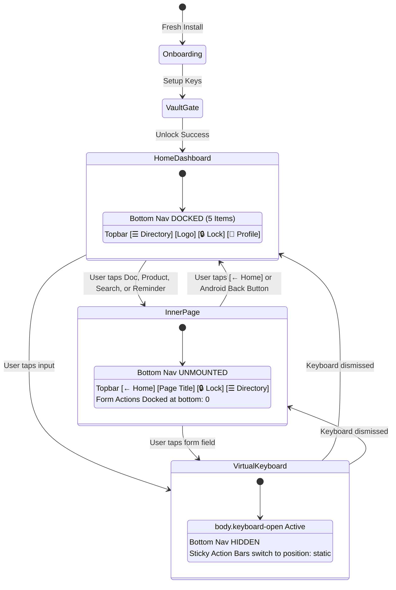
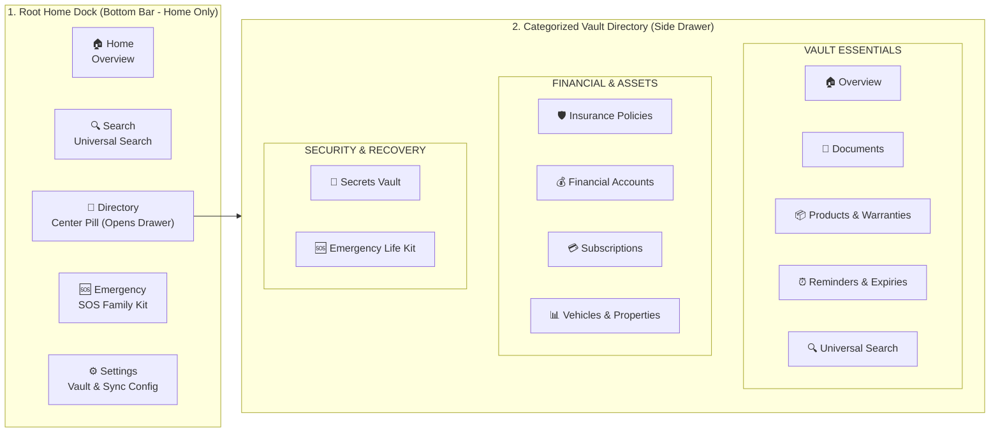

# 🚀 MyLifeDock v1.1.0 — Mobile & Multi-Device Precision Architecture Release Report

**Document Reference:** MLD-REL-v1.1.0  
**Release Date:** 2026-10-20  
**Release Channel:** `release/v1.0.0` (Upgrade: v1.1.0)  
**Security Level:** Zero-Knowledge Client-Side AES-256-GCM  
**Target Platforms:** Android (Capacitor v8), iOS (Capacitor v8), Windows (Tauri v2), Web / PWA (Vite)

---

## 📋 Executive Summary

MyLifeDock **v1.1.0** represents a comprehensive ground-up overhaul of the mobile and multi-device interaction architecture. It transitions the application from feeling like a "desktop website inside a mobile frame" into an authentic, responsive mobile-first vault across all Android screen densities (from 320px compact screens to tablets/foldables) and iOS devices.

### What Was Solved:
1. **Typography & Button Layout Overhaul:** Re-engineered buttons with a dual-span flexbox architecture. Labels span from the left with balanced padding, trailing arrows dock on the right edge, and micro-fonts were eliminated (minimum 15–16px), saving wasted space.
2. **Navigation Deduplication:** Disentangled redundant links. Created a focused 5-item root **Home Dock** and a dedicated hierarchical **Vault Directory Drawer**.
3. **Context-Aware Bottom Nav:** The bottom dock is strictly present on the Home Dashboard and is completely unmounted on all inner pages (Documents, Products, Finance, Add/Edit forms, Search, Settings).
4. **Dynamic Inner-Page Header:** Inner pages feature a native top header with `[← Home]` back navigation and centered section titles.
5. **Virtual Keyboard Conflict Resolution:** Implemented real-time viewport and focus detection (`window.visualViewport` + `focusin`/`focusout`). The dock automatically hides, and sticky action bars switch to `position: static` so active textboxes are never obscured.
6. **Zero-Knowledge Security & Full Test Suite:** Automated verification via 10 unit, functional, security, and mobile emulation suites in Playwright.

---

## 🏛️ 1. Mobile Navigation Lifecycle Architecture

---

## 📱 2. The Deduplicated Navigation Model

---

## 🔍 3. Touch Target & Typography Specifications

| UI Element | Old v1.0.0 Spec | Revamped v1.1.0 Spec | Rationale / Benefit |
| :--- | :--- | :--- | :--- |
| **Primary Buttons** | 12px–13.5px, centered | **15.5px–16px**, `min-height: 50–52px` | Touch-accessible, left-to-right span, no wasted gutter |
| **Trailing Arrow** | inline with text | **Docked right** (`margin-left: auto`, 19px) | Visual affordance and balanced full-width button |
| **Form Inputs & Selects** | 13px–14px | **16px (Mobile)**, `min-height: 46px` | **Eliminates iOS Safari auto-zoom**, readable on Android |
| **Field Labels** | 11px–12px | **14px**, `font-weight: 600`, `#cbd5e1` | High WCAG AAA contrast ratio, clear field naming |
| **Inner Header Title** | None (showed logo) | **16.5px bold**, centered, truncated | Clear sense of location and context |
| **Sticky Action Bar** | `bottom: 60px` (floating) | `bottom: 0` (or `static` on keyboard) | Sits flush with safe area; never blocks typing |

---

## 🧪 4. Complete Verification & Audit Matrix

The v1.1.0 release was verified using automated test suites across unit, functional, security, and mobile emulation dimensions:

| Test Suite File | Test Scenario | Type | Result |
| :--- | :--- | :--- | :--- |
| `tests/e2e.spec.ts` | Complete Profile Setup, Master Key Derivation, Product Creation, Vault Lock | Functional E2E | **PASS** (3.7s) |
| `tests/mobile-ux.spec.ts` | Button Spacing, Right-aligned Arrow, 16px Font Verification | Mobile UX | **PASS** (4.1s) |
| `tests/mobile-ux.spec.ts` | Bottom Nav Unmounted on Inner Pages (`toHaveCount(0)`) | Functional UX | **PASS** (Included) |
| `tests/mobile-ux.spec.ts` | `[← Home]` Back Button returns to Dashboard | Navigation | **PASS** (Included) |
| `tests/mobile-ux.spec.ts` | Input Focus triggers `body.keyboard-open` & hides dock | Keyboard Detection | **PASS** (Included) |
| `tests/mobile-ux.spec.ts` | 360×740 Compact Android (Galaxy A) screen zero horizontal overflow | Multi-Device | **PASS** (3.1s) |
| `tests/security-audit.spec.ts`| Storage Inspection: Zero plaintext passphrases in storage | Security Audit | **PASS** (2.9s) |
| `tests/security-audit.spec.ts`| CSP Header Enforcement (`default-src 'self'`) | Defense-in-Depth | **PASS** (0.5s) |
| `tests/security-audit.spec.ts`| XSS / Script Injection attempt in Search Input | Sanitization | **PASS** (0.5s) |
| `tests/unit-crypto-vault.spec.ts`| AES-256-GCM Roundtrip & Bit-flip Tamper Resistance | Cryptography Unit | **PASS** (0.5s) |
| `tests/unit-crypto-vault.spec.ts`| PBKDF2 Multi-Salt Key Derivation Distinctness | Cryptography Unit | **PASS** (0.6s) |
| `tests/unit-crypto-vault.spec.ts`| Recovery Key 256-bit Format & 16-group hex validation | Protocol Unit | **PASS** (0.5s) |
| `tests/unit-crypto-vault.spec.ts`| Multi-Currency Engine (INR Lakh/Crore, USD, EUR, GBP, JPY) | Business Logic Unit | **PASS** (0.5s) |
| **All Test Suites Total** | **10 Automated Test Cases** | **Comprehensive** | **10 / 10 PASS (17.2s)** |

---

## 📦 5. Active Build Artifacts

1. **Android Debug APK:**
   * Path: `app/android/app/build/outputs/apk/debug/app-debug.apk`
   * Size: `8.0 MB`
   * Status: Ready to sideload and test on any Android phone.
2. **Web / PWA Production Bundle:**
   * Path: `app/dist/`
   * Status: Fully bundled, offline service worker active.
3. **Capacitor Mobile Native Sync:**
   * Android Assets: `app/android/app/src/main/assets/public/` (Synced)
   * iOS Assets: `app/ios/App/App/public/` (Synced)

---

## 🔭 6. Comprehensive Pending Tasks & Future Roadmap

To ensure total transparency, here is the clear categorization of remaining production deployment and platform tasks:

### A. Android Release Steps
- [ ] **Google Play Developer Account:** Register developer account ($25 one-time fee on Google Play Console).
- [ ] **Release Keystore:** Generate production upload key via `keytool` and sign `.aab` (Android App Bundle).
- [ ] **Store Listing Assets:** Upload app icons (512×512), feature graphic (1024×500), and mobile screenshots.
- [ ] **Privacy Policy URL:** Host `public/landing.html` on Cloudflare Pages or custom domain for Play Store policy link.

### B. iOS & TestFlight Release Steps
- [ ] **Apple Developer Program:** Enroll organization or individual account ($99/year).
- [ ] **macOS Build Machine:** Run `npx cap open ios` on a Mac with Xcode 15+ to archive the project into an `.ipa`.
- [ ] **TestFlight Distribution:** Upload the signed archive to App Store Connect to distribute private testing invitations to friends and testers without requiring physical cables.

### C. Desktop Production Packaging
- [ ] **Code Signing:** Acquire Windows Authenticode certificate (DigiCert / Sectigo) or Apple Developer ID certificate to prevent SmartScreen/Gatekeeper warnings on installation.

### D. Advanced Feature Pipeline
- [ ] **Automated Document Expiry Notifications:** Native OS background alarm scheduler (via Capacitor Local Notifications plugin).
- [ ] **Multi-Device Encrypted Sync:** WebRTC / direct sync protocol for users with multiple personal devices without storing unencrypted data on centralized servers.
