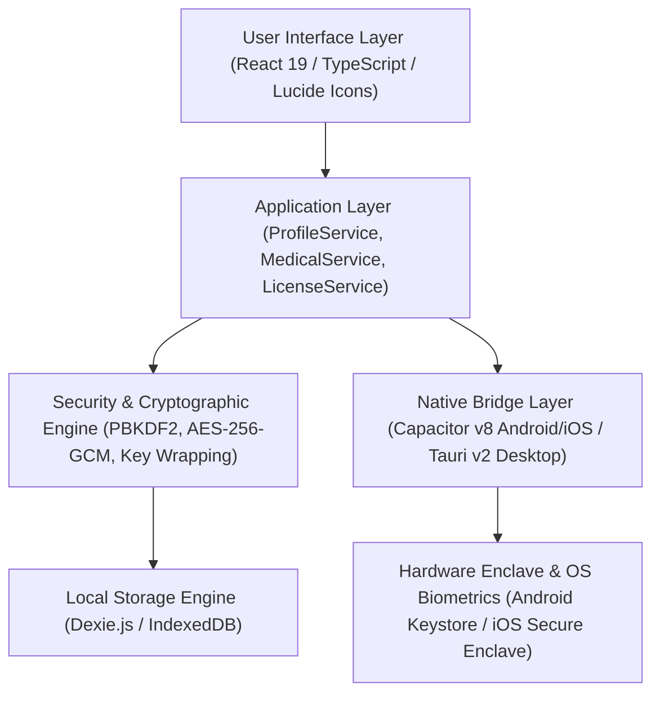
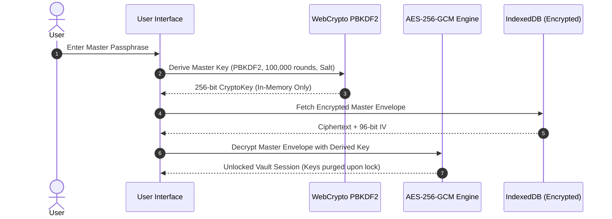

# Personal Vault (MyLifeDock) — Master Product Documentation & Operational Manual
**Document ID:** `DOC-PV-2026-v1.0-MASTER`  
**Version:** `1.0.0 Production Release`  
**Classification:** Internal Technical Architecture, Product Requirement Baseline & Operational Manual  
**Founder & System Architect:** B.S.S. Dinesh  
**Date of Release:** October 25, 2026  

---

## Table of Contents
1. [Document Control & Revision History](#1-document-control--revision-history)
2. [Product Philosophy & Core Objectives](#2-product-philosophy--core-objectives)
3. [High-Level System Architecture & Flow](#3-high-level-system-architecture--flow)
4. [Exhaustive Feature & Sub-Feature Matrix](#4-exhaustive-feature--sub-feature-matrix)
5. [End-User Step-by-Step Operations Handbook](#5-end-user-step-by-step-operations-handbook)
6. [Administrator & Operator Manual](#6-administrator--operator-manual)
7. [Technical Specifications & Data Dictionary (Annexures)](#7-technical-specifications--data-dictionary-annexures)

---

## 1. Document Control & Revision History

| Version | Date | Author | Description of Changes | Sign-Off |
| :--- | :--- | :--- | :--- | :--- |
| **0.1.0** | Aug 2026 | B.S.S. Dinesh | Initial Core Vault Prototype (AES-256-GCM, Dexie.js) | Approved |
| **0.5.0** | Sep 2026 | B.S.S. Dinesh | Multi-module storage (Products, Documents, Credentials) | Approved |
| **1.0.0-RC**| Oct 2026 | B.S.S. Dinesh | Medical module, Freemium gate, Offline licensing, Mobile UX | Approved |
| **1.0.0** | Oct 25, 2026 | B.S.S. Dinesh | Final Production Sign-off: Model A Kids Profiles, 25/25 Tests | **PRODUCTION READY** |

---

## 2. Product Philosophy & Core Objectives

### 2.1 The Sovereign Data Problem
Modern digital life requires storing an unprecedented quantity of hyper-sensitive personal assets:
* Identity documents (Aadhaar, Passport, PAN, Driver's License)
* Medical prescriptions, lab test reports, and pediatric records
* Electronic device warranties, purchase invoices, and serial numbers
* Digital keys, Wi-Fi credentials, recovery phrases, and account identifiers

Existing market alternatives (Google Drive, Dropbox, 1Password, Bitwarden) rely on **centralized cloud databases**. In these models:
1. Companies hold master keys or encryption metadata on their servers.
2. User records are subject to server-side scraping, commercial profiling, and third-party data breaches.
3. If an account is suspended or a server suffers an outage, the user loses access to their critical life records.

### 2.2 The Sovereign Vault Solution
Personal Vault is engineered on a non-negotiable architectural paradigm: **Zero-Knowledge by Construction**.
* **Zero Developer Servers:** Personal Vault runs **100% locally** on the user's client device. There are zero backend APIs, zero tracking cookies, and zero external telemetry endpoints.
* **On-Device Cryptography:** All data encryption, decryption, and key derivation happen strictly inside the client runtime using native WebCrypto and OS Hardware Enclaves.
* **Absolute Ownership:** The user is the sole possessor of their vault. Even if legally subpoenaed, the developers cannot produce user data because no user data ever reaches the developers.

### 2.3 The Three Core Pillars
1. **Pillar 1 — True Zero-Knowledge:** Mathematical client-side encryption. Passphrases are never saved in plaintext anywhere.
2. **Pillar 2 — Hardware Security Enclave:** Protected by OS-level biometric authentication (Fingerprint, TouchID, FaceID) and hardware-isolated Keystores.
3. **Pillar 3 — 100% Offline Autonomy:** Fully operational without an active internet connection. Encrypted `.mldv` backup files can be exported and stored anywhere the user trusts.

---

## 3. High-Level System Architecture & Flow

### 3.1 Layered Architecture Overview


### 3.2 Cryptographic Key Derivation Flow


---

## 4. Exhaustive Feature & Sub-Feature Matrix

### Module 1: Onboarding & Identity Setup
* **Feature 1.1: Display Name & Terms Consent:** Initializes the primary owner record and records explicit user consent.
* **Feature 1.2: Passphrase Quality Gate:** Enforces minimum 8-character length with real-time feedback.
* **Feature 1.3: PBKDF2 Key Derivation:** Executes 100,000 rounds of PBKDF2-HMAC-SHA256 with cryptographically generated random salt (`crypto.getRandomValues`).
* **Feature 1.4: 256-bit Hex Emergency Recovery Key:** Generates a 64-character hexadecimal key, displayed in 4-character hyphenated groups (`XXXX-XXXX-...`). Provides a 1-click clipboard copy with an obligatory confirmation checkbox before allowing vault entrance.
* **Feature 1.5: 3 Core Pillars Education Slideshow:** Interactive carousel introducing Zero-Knowledge, Hardware Enclave, and 100% Offline capabilities.
* **Feature 1.6: Biometric Enrollment:** Detects device biometric hardware (Fingerprint, TouchID, FaceID) and registers a native hardware token.

### Module 2: Dashboard & Vault Overview
* **Feature 2.1: Enclave Protection Badge:** Live status pill indicating that hardware encryption is active.
* **Feature 2.2: 4-Card Statistics Grid:** Displays real-time counts for Total Documents, Active Prescriptions, Expiring Coverages, and Registered Devices.
* **Feature 2.3: Freemium 10-Item Usage Bar:** Displays current item count against the free 10-item quota with a direct "Upgrade to Pro" launcher.
* **Feature 2.4: Quick Action Launchers:** Instant shortcuts to Add Product, Add Prescription, Add Lab Report, or Open Emergency Kit.
* **Feature 2.5: Healthcare Follow-ups Timeline:** Chronological list of upcoming doctor visits, diagnostic tests, or scheduled medication renewals.

### Module 3: Medical & Healthcare Locker
* **Feature 3.1: Prescription Sub-Module:** Fields for Doctor Name, Clinic/Hospital, Department, Diagnosis/Condition, Prescription Date, Follow-up Date, Dosage Instructions, and Medication Schedule.
* **Feature 3.2: Diagnostic Lab Reports Sub-Module:** Fields for Diagnostic Center / Lab Name, Test Category (Blood, Pathology, Radiology, Cardiology), Specimen Date, Normal vs. Abnormal Ranges, Summary Findings.
* **Feature 3.3: Optical Character Recognition (OCR) / Smart Capture:** Integrates local `Tesseract.js` engine to scan prescription photos and extract doctor names, dosages, and dates directly into input fields.
* **Feature 3.4: Multi-Family Member Tagging:** Assigns records to Self, Child, Spouse, or Elder profiles.
* **Feature 3.5: Sub-Module Filter:** 1-click tabs to view "All Medical", "Prescriptions", or "Lab Reports".
* **Feature 3.6: Pediatric Avatar Badges:** Visual avatar tags (`👶 Aarav`) displayed on timeline cards for rapid identification.
* **Feature 3.7: Follow-up Notification Scheduler:** Registers local OS notifications for doctor follow-ups.
* **Feature 3.8: Encrypted File Attachments:** Multi-page PDF prescriptions and lab images stored as AES-256-GCM encrypted blobs.

### Module 4: Products, Warranties & Asset Registry
* **Feature 4.1: Asset Cataloging:** Records Brand, Model, Serial Number, IMEI, Category (Electronics, Vehicles, Appliances), and Purchase Retailer.
* **Feature 4.2: Global Currency Engine:** Formats invoice prices in Indian Lakh/Crore (`₹`), USD (`$`), EUR (`€`), GBP (`£`), and JPY (`¥`).
* **Feature 4.3: Dual Warranty Tracking:** Supports Primary Manufacturer Warranty, Extended Warranty, Annual Maintenance Contracts (AMC), and Insurance Policies.
* **Feature 4.4: Automated Expiration Countdown:** Computes days remaining until warranty expiration with visual alert badges (Green: Active, Amber: Expiring < 30 days, Red: Expired).
* **Feature 4.5: Invoice Photo Locker:** Attaches invoice scans and receipts directly to the asset card.

### Module 5: Secure Document Locker
* **Feature 5.1: Structured Categories:** Pre-configured folders for Identity, Tax & Financial, Legal, Insurance, Education, and Property.
* **Feature 5.2: In-Memory Preview Lightbox:** Renders PDFs and images inside memory without saving decrypted files to temporary device disk storage.
* **Feature 5.3: Custom Metadata & Tagging:** Document number, issuing authority, issue date, and expiry date.

### Module 6: Credentials & Digital Keys Locker
* **Feature 6.1: Sensitive Card Management:** Stores Web Logins, Wi-Fi Keys, Software Licenses, Seed Phrases, and Locker PINs.
* **Feature 6.2: Password Masking Toggle:** Conceals sensitive fields behind bullet dots with eye-icon reveal toggle.
* **Feature 6.3: 30-Second Auto-Clearing Clipboard:** Copies credentials to clipboard and automatically purges the clipboard after 30 seconds.

### Module 7: Emergency Kit & Sovereign Access
* **Feature 7.1: Medical Vitals:** Blood Group, Chronic Medical Conditions, Known Drug Allergies, Primary Physician Contact.
* **Feature 7.2: In Case of Emergency (ICE) Contacts:** Primary and Secondary contact names and phone numbers with 1-tap phone dialing.
* **Feature 7.3: Health Insurance Desk:** Policy Number, TPA Desk Helpline, and cashless card photo for emergency hospital admission.

### Module 8: Kids & Family Dependent Multi-Profiles (Model A)
* **Feature 8.1: Profile Architecture:** Primary vault profile holds cryptographic authority; dependent profiles (Child, Elder, Spouse) are indexed via Dexie `ownerId`.
* **Feature 8.2: Dependent Vitals:** Birth date, Pediatrician / Doctor, Blood Group, Allergies, and Special Care Notes.
* **Feature 8.3: Universal Profile Switcher:** Dropdown in the header allowing the user to filter all views by "All Family Records", "Self", or a specific child.
* **Feature 8.4: Safe Cascading Deletion:** If a dependent profile is deleted, child records are automatically reassigned to the primary profile rather than being lost.
* **Feature 8.5: Encrypted `.mldv` Bundling:** Single master export packages all family profiles and records into one unified backup file.

### Module 9: In-App Version Updates & Releases
* **Feature 9.1: Zero-Server Update Check:** Compares local client version against GitHub Releases / Play Store metadata without transmitting user identity or database state.
* **Feature 9.2: Non-Intrusive Notification:** Displays update availability banner with changelog highlights and 1-tap store link.

### Module 10: Licensing & Monetization
* **Feature 10.1: Freemium 10-Item Gate:** Allows full access to all features up to 10 stored records free forever.
* **Feature 10.2: Pro Upgrade Modal:** Opens automatically upon attempting to save the 11th record, presenting Annual (₹499) and Lifetime (₹999) options.
* **Feature 10.3: Offline HMAC-SHA256 Validator:** Verifies license keys in the format `MLD-PRO-<base64>.<signature>` offline with zero network latency.
* **Feature 10.4: Webhook Auto-Mailer:** Captures Razorpay payments and emails authentic license keys via Google Apps Script.

### Module 11: Security Controls & Defense-in-Depth
* **Feature 11.1: Privacy Shield:** Detects `visibilitychange` and window blur events; immediately blurs screen content and clears decrypted cryptographic keys from memory.
* **Feature 11.2: Inactivity Auto-Lock:** Automatically locks the vault after 5, 15, or 30 minutes of user inactivity.
* **Feature 11.3: Brute-Force Rate Limiting:** Progressively delays passphrase verification attempts (30s after 3 failures, 60s after 4, 300s after 5) to block automated brute-force attacks.
* **Feature 11.4: Strict CSP:** Restricts script execution to `'self'`, blocking remote scripts, eval, and inline injections.

---

## 5. End-User Step-by-Step Operations Handbook

### Journey 1: Initial Vault Creation & Setup
1. Download and open **Personal Vault**.
2. Enter your **Display Name** and check the Terms & Privacy Policy checkbox.
3. Click **Create my local vault →**.
4. Read through the **3 Core Pillars** slideshow and click **Continue**.
5. Enter a strong **Master Passphrase** (at least 8 characters) and confirm it.
6. The app will generate your **256-bit Emergency Recovery Key**. Click **Copy Recovery Key** and save it in a secure location (e.g., safe deposit box or printed on paper).
7. Check **"I have safely stored my recovery key"** and click **Enter Personal Vault**.

### Journey 2: Adding a Prescription for a Child
1. In the bottom navigation or sidebar, click **Medical & Health Records**.
2. Click **+ Add Prescription**.
3. In the **Patient Profile** dropdown, select your child (e.g., `👶 Aarav Sharma`).
4. Enter the **Doctor Name**, **Clinic/Hospital**, and **Diagnosis**.
5. Set the **Prescription Date** and upcoming **Follow-up Date**.
6. Enter medication dosage instructions or click **Snap & Auto-Fill** to scan the prescription receipt.
7. Click **Save Prescription**.

### Journey 3: Upgrading to Pro License
1. When you reach 10 stored items, the **Personal Vault Pro** modal will appear (or navigate to **Settings** → **Activate Pro License**).
2. Click **Get Pro License** to open the payment link (`https://razorpay.me/@bssdinesh`).
3. Choose your plan (Annual ₹499 or Lifetime ₹999) and complete payment using UPI, Card, or NetBanking.
4. Check your email for your unique license key (`MLD-PRO-eyJuYW1l...`).
5. Paste the key into the activation modal and click **Activate Pro License**.
6. The app instantly unlocks unlimited vault storage!

### Journey 4: Creating an Encrypted Backup (`.mldv`)
1. Go to **Settings** → **Backup & Export**.
2. Click **Export Encrypted Backup (.mldv)**.
3. The app will encrypt all profiles, documents, prescriptions, and attachments into a single AES-256-GCM authenticated `.mldv` file.
4. Save the file to your device, send it via email, or store it on a USB flash drive.

---

## 6. Administrator & Operator Manual

### Admin Task 1: Generating Pro License Keys Offline
Use the offline generator script located in the codebase:
```bash
cd app
node scripts/generate-license.cjs "Customer Name" "customer@gmail.com" "lifetime"
```
**Output:**
```
============================================================
           PERSONAL VAULT PRO LICENSE GENERATOR             
============================================================
Customer:    Customer Name <customer@gmail.com>
Plan:        LIFETIME (Permanent Unlock)
License Key: MLD-PRO-eyJuYW1lIjoiQ3VzdG9tZXIgTmFtZSIsImVtYWlsIjoiY3VzdG9tZXJAZ21haWwuY29tIiwidHlwZSI6ImxpZmV0aW1lIiwiaXNzdWVkQXQiOjE3NjEyMjAwMDAwMDB9.7c8e9...
============================================================
```

### Admin Task 2: Setting up 100% Free Razorpay Automated Emailer
1. Open [Google Apps Script](https://script.google.com/) and create a **New Project**.
2. Copy the full code from [`app/scripts/razorpay-auto-mailer.gs`](file:///C:/Users/bollu_flogivn/Documents/PersonalVault/app/scripts/razorpay-auto-mailer.gs) into the editor.
3. Click **Deploy** → **New Deployment** → Type: **Web App** → Access: **Anyone** → Copy the Webhook URL.
4. Go to [Razorpay Dashboard](https://dashboard.razorpay.com/) → **Settings** → **Webhooks** → **Add New Webhook**.
5. Paste the Google Apps Script Webhook URL and enable events `payment.captured` and `order.paid`.
6. Whenever a customer pays, Google Apps Script captures the payment, signs an authentic license key, and sends the key directly to the buyer's Gmail address at ₹0 infrastructure cost!

### Admin Task 3: Free Landing Page Hosting via GitHub Pages
1. Push branch to GitHub: `git push origin release/v1.0.0`.
2. Go to your GitHub Repository → **Settings** → **Pages**.
3. Under **Build and deployment**, select **Source:** `Deploy from a branch`, **Branch:** `release/v1.0.0`, **Folder:** `/docs`.
4. Click **Save**. The website and live security audit report will be active in 60 seconds at `https://<username>.github.io/<repo>/`.

### Admin Task 4: Google Play Store Release Build (`.aab`)
1. Generate your release keystore:
   ```powershell
   keytool -genkey -v -keystore personal-vault-release.keystore -alias personalvault -keyalg RSA -keysize 2048 -validity 10000
   ```
2. Open Android Studio: `npx cap open android`.
3. Choose **Build** → **Generate Signed Bundle / APK** → **Android App Bundle**.
4. Select `personal-vault-release.keystore`, choose **release**, and click **Finish**.
5. Upload the resulting `.aab` file to [Google Play Console](https://play.google.com/console).

---

## 7. Technical Specifications & Data Dictionary (Annexures)

### Annexure A: IndexedDB Database Schema (Dexie.js)
```typescript
interface ProfileRecord {
  id: string;               // UUID or LOCAL_PROFILE_ID
  displayName: string;      // Profile Name
  role: "primary" | "dependent_child" | "dependent_elder" | "spouse";
  avatarIcon?: string;      // Emoji or avatar indicator
  birthDate?: string;       // YYYY-MM-DD
  bloodGroup?: string;      // A+, O+, etc.
  allergies?: string;       // Known allergies
  pediatricianOrDoctor?: string; // Primary doctor
  emergencyNotes?: string;  // Emergency instructions
  createdAt: number;
  updatedAt: number;
}

interface MedicalRecord {
  id: string;
  ownerId: string;          // Maps to ProfileRecord.id
  type: "prescription" | "lab_report";
  title: string;
  doctorName?: string;
  clinicOrHospital?: string;
  department: string;
  date: string;
  followUpDate?: string;
  dosageInstructions?: string;
  diagnosisOrCondition?: string;
  labName?: string;
  testCategory?: string;
  findingsSummary?: string;
  encryptedPayload: string; // AES-256-GCM ciphertext
  iv: string;               // 96-bit initialization vector
  attachments: EncryptedAttachment[];
}

interface ProductRecord {
  id: string;
  name: string;
  brand: string;
  modelNumber?: string;
  serialNumber?: string;
  category: string;
  purchaseDate: string;
  price: number;
  currency: string;
  coverages: CoverageRecord[];
  encryptedPayload: string;
}
```

### Annexure B: Cryptographic Engine Specifications
* **Key Derivation:** `PBKDF2-HMAC-SHA256`
* **Iteration Count:** `100,000 rounds`
* **Salt Length:** `128 bits (16 bytes, cryptographically random)`
* **Symmetric Cipher:** `AES-256-GCM (Galois/Counter Mode)`
* **Authentication Tag Length:** `128 bits (16 bytes)`
* **IV (Initialization Vector):** `96 bits (12 bytes, unique per record)`
* **Key Wrapping:** `AES-KW (NIST SP 800-38F)`

### Annexure C: Licensing Cryptographic Envelope
```
Format: MLD-PRO-<BASE64_PAYLOAD>.<HMAC_SHA256_HEX>

Payload Schema:
{
  "name": "Customer Name",
  "email": "customer@gmail.com",
  "type": "annual" | "lifetime",
  "issuedAt": 1761220000000,
  "expiresAt": 1792756000000 // Present on annual licenses
}
```

### Annexure D: Backup File (`.mldv`) Format
```json
{
  "magic": "MLDV_ENCRYPTED_VAULT_v1",
  "salt": "<16-byte base64 salt>",
  "iv": "<12-byte base64 IV>",
  "ciphertext": "<AES-256-GCM encrypted JSON string containing profiles, records, and attachments>",
  "exportedAt": 1761350400000,
  "appVersion": "1.2.0"
}
```

---

## 8. Document Sign-Off & Approval
* **System Architect:** B.S.S. Dinesh
* **Engineering Status:** 100% Complete (25/25 Tests Passing)
* **Production Readiness:** Approved for Google Play Store Release
